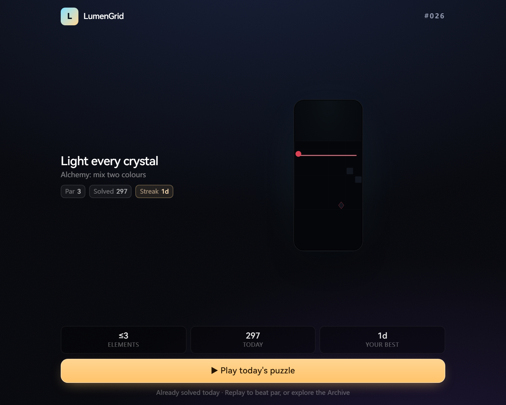
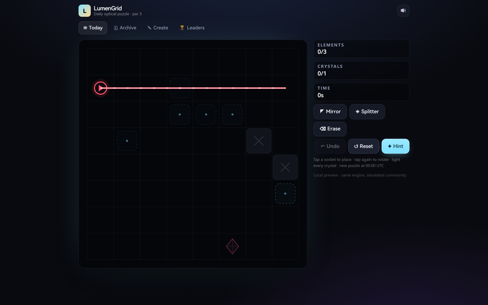
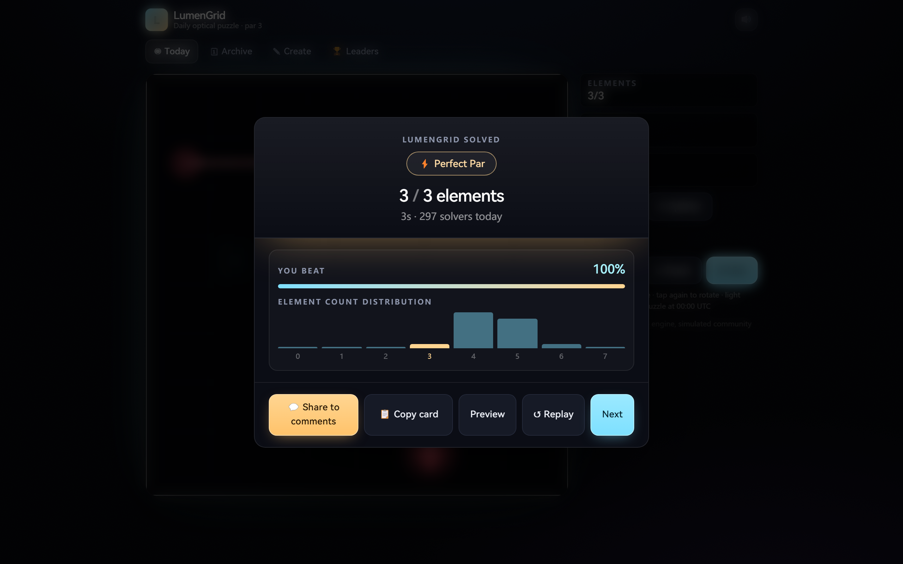
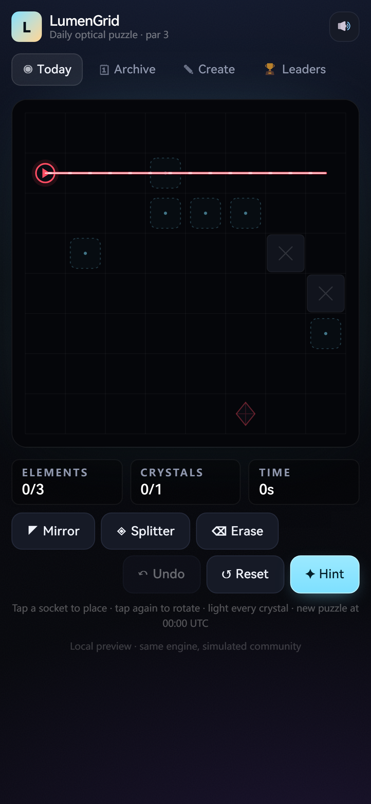
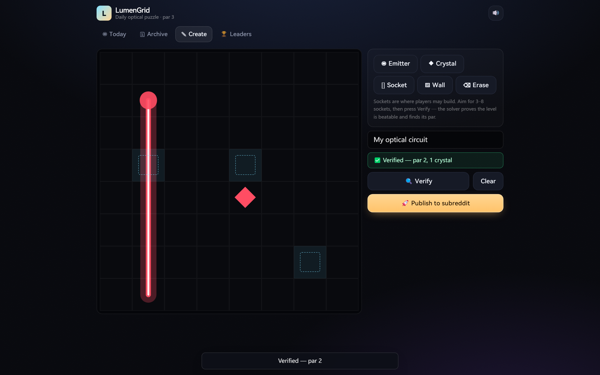
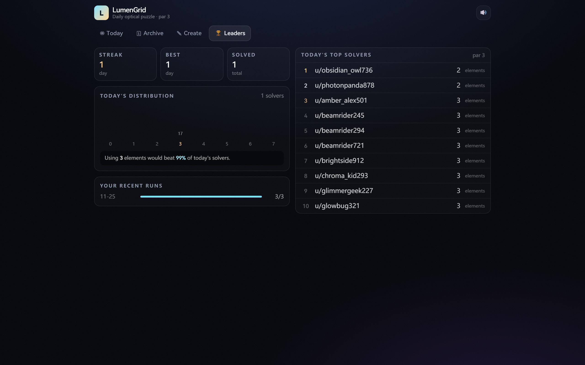

# LumenGrid

**A daily optical laser puzzle for Reddit.** Eight-by-eight obsidian board, coloured beams, mirrors and
splitters, one shared puzzle for every player in the world, and a comment you can paste without
spoiling it for anyone.

Built for the [Reddit Game of the Day Hackathon](https://redditgameofday2026.devpost.com) on
**Devvit Web** — React + Hono running as an interactive post, no iframe tricks, no external hosting.



---

## The game

Every day at 00:00 UTC a new board appears, identical for everyone. An emitter fires a coloured beam.
One or more crystals need light of an exact colour. Between them sit a handful of **optical sockets** —
the only cells you may build on.

Two elements go in those sockets:

| Element | Symbol | Behaviour |
| --- | --- | --- |
| **Mirror** | `/` or `\` | Turns the beam 90°. Tap again to flip it. |
| **Splitter** | `/` or `\` | Passes the beam straight through **and** reflects a copy at 90°. |

Tap a socket to place, tap again to rotate, tap with the eraser to remove. Solve it and you get a
**Par** badge: 💎 under par, ⚡ exactly on par, ✨ solved but over.

### Colour is part of the puzzle

Beams carry RGB channels, and channels superpose. A red beam crossing a green beam is yellow at the
crossing. Crystals ask for a specific mix:

| Red | Green | Blue | Mixed |
| --- | --- | --- | --- |
| 🟥 `R` | 🟩 `G` | 🟦 `B` | 🟨 `R+G` · 🟪 `R+B` · 🩵 `G+B` · ⬜ `R+G+B` |

By Friday the boards grow filters that strip channels, and by the weekend you are routing three
crystals through one beam path.

### The week is a difficulty curve

| Day | Theme | Par | Crystals | Sockets |
| --- | --- | --- | --- | --- |
| Mon | Warm-up: trace the beam | 2 | 1 | 5 |
| Tue | Two bounces | 2 | 1 | 5 |
| Wed | First split: one beam, two gems | 3 | 2 | 6 |
| Thu | Alchemy: mix two colours | 2–3 | 1 | 6 |
| Fri | Filters: let the right light through | 3 | 2 | 6 |
| Sat | Satellite array: light two gems | 4 | 2 | 7 |
| Sun | Master circuit | 4 | 3 | 8 |

365 days are generated from the season start (`2026-11-01`), deterministic and offline — no cron job
decides the puzzle, `fnv1a("lumengrid:v5:" + date)` does. The scheduler only posts it.

---

## What makes it Reddit-native

These are the parts that would not exist if this were a web game with a Reddit skin.

**One-click spoiler-free sharing.** The victory card posts a comment *as the player*, in the post they
are already reading, with `reddit.submitComment({ runAs: 'USER' })`. It says how many elements you
used and how long you took — never where you put them.

```
🔆 LumenGrid #025 — ⚡ Perfect Par
🟥🟥  ·  3/3 elements  ·  2m 14s
🔥 4-day streak
Can you light every gem with fewer?
```

The coloured squares are the day's crystal palette — one square per crystal, in the colour each one
needs. A spoiler-free hint at the puzzle's colour theme, and a way for a reader to tell at a glance
whether they played the same board.

**A daily leaderboard with a distribution, not just a ranking.** The histogram is derived from the
Redis sorted set rather than a separate counter, so it can never drift out of step with the board.
"Using 4 elements would beat 82% of today's solvers" is computed live.

**Community levels.** Any player can open **Create**, paint an emitter, a crystal and some sockets,
and press *Verify*. The server runs the same exact solver and refuses to publish anything it cannot
prove beatable — a subreddit never gets a permanently broken puzzle on its front page. Publishing
calls `reddit.submitCustomPost({ runAs: 'USER' })`, so the level appears as a real interactive post
authored by that player.

**Flair that means something.** Streaks tier up through `Lightbringer` (day 1) → `Beam Rider`
(3 days) → `Prism Adept` (7) → `Lumen Master` (30), and the flair carries the badge (💎 / ⚡ / ✨)
plus the streak count.

**Moderator tools.** Three subreddit menu items: post today's puzzle, post a community level, show
today's stats. Plus an `onAppInstall` trigger that posts the first puzzle and a `0 0 * * *` scheduler
task for every day after.

---

## Screenshots

| | |
| --- | --- |
| **Desktop** — board and controls side by side | **Victory** — badge, percentile, distribution |
|  |  |
| **Phone** — 390×844, board fully on the first screen | **Community studio** — author a level, solver proves it |
|  |  |



### Demo

[`docs/demo/lumengrid-demo.mp4`](docs/demo/lumengrid-demo.mp4) — about 48 seconds, H.264 walkthrough:
feed card → play → hint → solve → share → leaderboard → community studio.

---

## Running it

```bash
npm install
npm run test:types     # tsc --build across the four tsconfig projects
npm test               # 100 tests, including a full 365-day sweep
npm run check          # the above, plus lint and a dead-export scan
npm run build          # → dist/client + dist/server/index.cjs (this is what Devvit deploys)
```

`npm run check` is worth knowing about because two defects shipped that nothing else would
have caught: a flair function that was defined, correct and never called, and four exported
helpers with no callers at all. Both are invisible to tests (nothing misbehaves) and to
`tsc`/ESLint's unused-variable rules (which work per file, so an export with no importer looks
used). `scripts/check-dead-exports.mjs` does the cross-file count, and exits non-zero.

`devvit.json` had the same shape of blind spot. It is not TypeScript, so `tsc` never sees it, and
no test read it. An invalid permission block therefore passed `npm test`, `tsc`, `eslint` and
`npm run build`, and failed only when someone ran a Devvit CLI command — with a message that names
the failing subschema and not the offending key. `tests/config.test.ts` now parses the real file
with the real schema the CLI uses, so a bad key fails here first.

### On Reddit

There are two gates before the CLI will do anything, and neither is mentioned by the command that
fails on it.

**1. A Reddit developer account.** Every command that talks to Reddit — `playtest`, `upload`,
`publish`, `install`, `logs` — calls `checkDeveloperAccount()` before it looks at your app at all.
The check compares `acceptedTermsVersion` against `currentTermsVersion`, so an account that does not
exist fails it the same way an account with stale terms does. What you get is a URL and a menu:

```
Please finish setting up your developer account before proceeding:
https://developers.reddit.com/create-account?cli=true
```

That page is the one that matters — **not** `developers.reddit.com/apps`. An empty app list looks
identical whether or not the account behind it exists, which is an easy way to conclude you are set
up when you are not.

**2. A test subreddit you moderate.** `playtest` reads `dev.subreddit` from `devvit.json`; if it is
unset it tries to create `r/[app-name]_dev` for you, and creating a subreddit needs a captcha
solved by a person. Set the name yourself once the subreddit exists, and note that the CLI verifies
the *account is a moderator* server-side — the error when it is not does not say so.

```bash
npx devvit login                     # authenticate against your Reddit account
npx devvit playtest r/your_test_sub  # installs the app on your test subreddit
```

`playtest` builds, uploads and installs the app, then gives you a link to your test subreddit. Make a
post via the subreddit menu (**Post today's LumenGrid**) and it runs there against real Redis and a
real Reddit account.

### Locally, without a Reddit account

```bash
npm run build:preview   # builds the same client + a standalone Hono server
npm run preview         # http://127.0.0.1:41731
```

The local server implements the same `GameAdapter` interface as the Devvit one, over an in-memory
store seeded with ~200 realistic community solves — so the leaderboard, histogram, percentile and
streak maths are exercised exactly as they will be on Reddit.

### Re-recording the showcase

```bash
npm run build:preview
npm run showcase
```

This drives a real Chromium against the production bundle and fails the build (non-zero exit) if:
any viewport overflows horizontally, the board does not fit on a phone's first screen, any control is
smaller than 20px, the share card leaks a coordinate, the victory timer never advanced, the solver
rejects the studio's sample level, or any console error / uncaught exception appears. It writes the
six screenshots and re-encodes the demo video (ffmpeg on `PATH`, or set `LUMENGRID_FFMPEG`).

There is one more check the showcase does not cover, because it needs to solve the board the way a
player does:

```bash
npm run build:preview
npm run probe:leaderboard
```

This plays today's board with real taps, dismisses the victory card, and opens **Leaders** without
reloading — the actual sequence a player follows. It fails if the player is missing from the top
list. That failure mode was real: the submit response carried no top-solvers list, so the panel
rendered a pre-solve snapshot and your own name was absent exactly when you went to look for it.

And one the showcase would have missed even if it were looking, because the showcase opened the
feed card at 800×640 — a size no Reddit surface uses:

```bash
npm run build:preview
npm run probe:splash
```

Reddit sizes the interactive-post iframe itself. Measured on `r/lumengrid_game_dev2`, a desktop
embed is **732 × 512**, and a phone's is shorter. The feed card had `min-h-[600px]` on its root, so
on a 512px frame the layout pushed the **Play button to y=561 — 49px below the fold**, and
`body.no-scroll` meant it was clipped, not scrollable. The first screen a judge ever sees had no way
to start the game. The fix is structural: the card is now a three-row grid whose middle row is
`minmax(0,1fr)`, and the preview board is the one element that grows or shrinks with the available
height. That also removed a 263px black band the old `justify-between` left under the header.

`npm run probe:splash` asserts, at 732×512, 640×480, 390×420 and 390×360, that the Play button is
fully inside the viewport, that nothing overflows, and that no single empty band exceeds ~18% of the
frame. Restoring `min-h-[600px]` turns eight of those assertions red.

---

## How it works

```
src/
  shared/         runs unchanged on the client, the Devvit server and the local preview
    types.ts        8×8 grid, packed cell codes, colour masks
    optics.ts       beam tracer — RGB channels traced independently, then OR-ed
    solver.ts       exact iterative-deepening search; returns the *true* minimum
    generator.ts    deterministic daily puzzles (365 days, weekly curve)
    share.ts        badges, histogram percentiles, share-card text
    api.ts          the wire contract — a change breaks the build, not the game
  server/
    game-service.ts  scoring, streaks, leaderboard, hints, anti-cheat, UGC
    routes/          thin Hono routes over that service
    adapters/
      devvit-adapter.ts   @devvit/web/server — Redis and the Reddit API
      local-adapter.ts    in-memory, for the preview and Playwright
  client/
    game.tsx          the game shell: tabs, board, toolbar, victory
    splash.tsx        the feed card — a live board before anyone taps
    components/       OpticsBoard, VictoryModal, LeaderboardPanel, UgcStudio
    lib/audio.ts      Web Audio pentatonic synth, no asset downloads
```

### Par is proven, not estimated

"Par" is the number the whole social layer hangs on — the badge, the histogram, the leaderboard. If
Par were computed by a heuristic it would be wrong on some days, and every player who beat it would
be told they did not.

Two things make an *exact* solver affordable in a request:

1. **The build zone is declared.** Levels list `mounts` — typically 5 to 8 sockets. Searching
   `C(8,4)·4⁴` configurations is a millisecond; searching the same depth over 64 free cells is not.
2. **Iterative deepening with no heuristic pruning.** `solve()` exhausts every configuration of size
   `0, 1, …, d−1` before accepting a solution of size `d`, so the returned Par is the true optimum.
   Nothing in the search can rule out a smaller answer.

The 365-day test re-proves this for every day of the season, independently of the generator: it
regenerates each puzzle, solves it, and cross-checks Par against the theme's declared band. Slowest
single day: under 1.5 seconds (asserted).

### Hints that respect what you already built

The hint endpoint does not replay a stored answer. It re-solves *the rest of the board* around the
player's existing elements — passed to the solver as `pinned`, which both fixes them in place and
removes their cells from the build zone. So a hint always extends your work instead of contradicting
it, even if you have built something the level's author never imagined.

### Anti-cheat

The client sends its 64 placement codes; the server ignores any claim that the board is solved and
re-runs the tracer itself. Elements outside `mounts`, elements stacked on furniture, and element codes
out of range are all rejected. A first solve drives the streak and the solve count; replaying a day
can improve your score but never double-counts, so farming is pointless.

### Sound without weight

Every cue is a few oscillators and an envelope — no audio files, so zero download inside the feed and
no licensing surface. The palette is a major pentatonic scale, so any two cues that overlap are
consonant, and each crystal that lights climbs one scale degree: solving a board resolves into a
chord rather than a jingle.

---

## Testing

```
tests/optics.test.ts       22 tests   colour mixing, reflection geometry, splitters, filters
tests/solver.test.ts       20 tests   minimality, inventory, pinned elements, brute-force cross-check
tests/daily-365.test.ts    10 tests   all 365 days: solvable, Par-correct, theme-correct, fast enough
tests/api.test.ts          37 tests   every route, anti-cheat, streaks, flair, sharing, UGC verification
tests/config.test.ts        6 tests   devvit.json parses under the CLI's own schema; slug, scopes, plugins pinned
tests/bridge.test.ts        5 tests   the client→server request carries Devvit's token, to the right origin
```

The solver suite cross-checks its answers against an independent exhaustive search on random boards,
and the 365-day suite re-derives Par for every single day.

---

## Licence

BSD-3-Clause.
